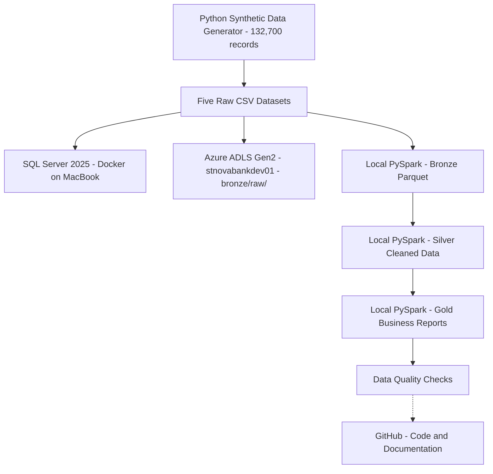

# NovaBank — Data Engineering Architecture

This document describes the implemented NovaBank data engineering workflows.

## Implementation Notes

- Python generates five synthetic banking CSV datasets totaling 132,700 records.
- SQL Server 2025 supports relational queries, fraud analysis, and reconciliation.
- Azure Data Lake Storage Gen2 stores uploaded raw CSV files in the Bronze container.
- The current PySpark pipeline runs locally and reads CSV files from `data/raw/`, not directly from Azure.
- `Spark/run_pipeline.py` runs the Bronze, Silver, Gold, and data quality stages.
- Gold reports include daily transactions, transaction summaries, payment summaries, and high-value transaction review indicators.
- GitHub stores project code and documentation, not generated datasets.
