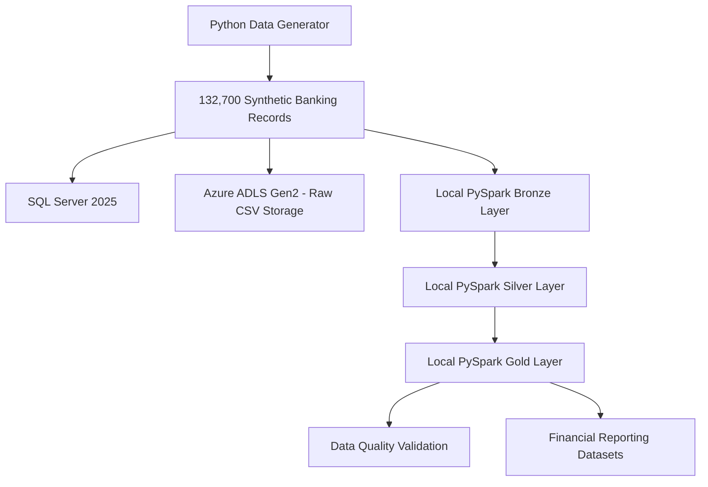

# NovaBank — Data Engineering Architecture

## Architecture Diagram

## Technologies

- Python
- SQL Server 2025
- Azure Data Lake Storage Gen2
- Apache PySpark
- Parquet
- Git and GitHub

## Implementation Notes

The Azure storage workflow and local PySpark pipeline
are separate in the current implementation.

The local pipeline reads CSV files from data/raw/
and produces Bronze, Silver, and Gold Parquet datasets.
